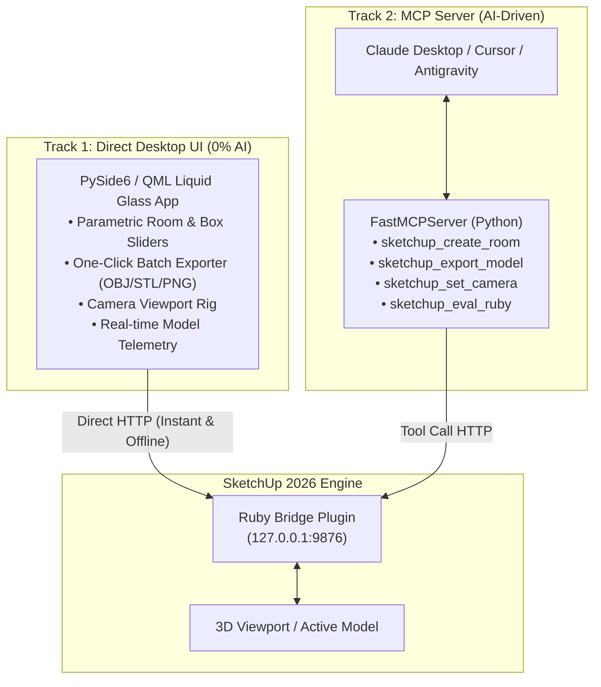

# Liquid SketchUp 2026 Controller (Desktop App + MCP Server)

A unified system to control **SketchUp 2026** programmatically. It provides:
1. **Track 1 (Desktop UI):** A hardware-accelerated **PySide6 / QML** desktop app featuring a **Liquid Light Glass** aesthetic for 100% deterministic, zero-AI parametric modeling and exporting.
2. **Track 2 (MCP Server):** An Anthropic **Model Context Protocol (MCP)** server that exposes the same SketchUp capabilities as tools to AI agents (Claude Desktop, Cursor, Antigravity).

---

## Architecture



---

## Directory Structure

```
sketchup-controller/
├── desktop-app/              # PySide6 + QML Liquid Light Glass Desktop App
│   ├── main.py               # Application entry point
│   ├── backend.py            # Asynchronous Qt bridge to SketchUp REST API
│   └── main.qml              # Liquid Light Glassmorphism UI
├── sketchup-plugin/          # SketchUp 2026 Ruby Extension
│   ├── sketchup_controller.rb # Extension registrar
│   ├── mock_server.py        # Local simulator for testing UI without SketchUp
│   └── sketchup_controller/
│       ├── loader.rb         # Extension bootstrapper & UI menus
│       ├── server.rb         # Non-blocking TCPServer HTTP API (Port 9876)
│       ├── geometry.rb       # Procedural parametric room/box generation
│       └── exporter.rb       # Exporters (OBJ, STL, DAE, 4K PNG renders)
├── mcp-server/               # Track 2: Model Context Protocol Server
│   ├── sketchup_mcp.py       # FastMCP Tools & Resources definition
│   └── claude_desktop_config.json # Plug-and-play config for Claude Desktop
├── install_plugin.sh         # Symlinks plugin to SketchUp 2026 Plugins folder
├── launch_desktop_app.sh     # Starts the PySide6 QML desktop window
└── venv/                     # Python 3.14 virtual environment with PySide6 & MCP
```

---

## Quick Start Guide

### 1. The SketchUp Plugin
The plugin is already symlinked to your SketchUp 2026 directory:
`~/Library/Application Support/SketchUp 2026/SketchUp/Plugins/sketchup_controller.rb`

* Launch **SketchUp 2026**.
* The server will automatically start on `http://127.0.0.1:9876`.
* You can check status in SketchUp under menu: `Extensions > SketchUp Controller > Server Status`.

*(Optional)* If SketchUp is not open and you want to test the UI or MCP with simulated data, run:
```bash
./venv/bin/python3 sketchup-plugin/mock_server.py
```

### 2. Launch the Liquid Light Glass Desktop App (Track 1)
Run the launcher:
```bash
./launch_desktop_app.sh
```
* **Parametric Design:** Tweak room dimensions (width, depth, height, wall thickness) with sliders and click **"⚡ Generate 3D Room"**.
* **Camera Views:** 1-click presets for **Isometric 3D**, **Top Floor Plan**, **Front**, and **Side Elevations**.
* **Export Studio:** One-click export to **OBJ**, **STL**, **DAE**, or **4K PNG Viewport Render**.
* **Model Telemetry:** Live count of faces, edges, groups, and bounding box dimensions.

---

### 3. Using the MCP Server with AI Agents (Track 2)

#### For Claude Desktop:
Copy the contents of `mcp-server/claude_desktop_config.json` into:
`~/Library/Application Support/Claude/claude_desktop_config.json`

```json
{
  "mcpServers": {
    "sketchup": {
      "command": "/Users/amraouimohamed/sites/sketchup-controller/venv/bin/python3",
      "args": [
        "/Users/amraouimohamed/sites/sketchup-controller/mcp-server/sketchup_mcp.py"
      ]
    }
  }
}
```

Now you can prompt Claude:
> *"Create a 10m by 7m studio with 3m ceilings, switch to top view, and export it as an OBJ to my Desktop."*

---

## REST API Endpoints (127.0.0.1:9876)

| Method | Endpoint | Description | Payload |
|---|---|---|---|
| `GET` | `/api/status` | Active model metadata, units, entities count, bounding box | None |
| `POST` | `/api/design/room` | Generate parametric room with walls & floor | `{"width": 6.0, "depth": 5.0, "height": 3.0, "wall_thickness": 0.2}` |
| `POST` | `/api/design/box` | Generate 3D box massing | `{"width": 4.0, "depth": 4.0, "height": 3.0}` |
| `POST` | `/api/design/cylinder` | Generate architectural column | `{"radius": 1.0, "height": 4.0, "segments": 24}` |
| `POST` | `/api/design/clear` | Clear active entities | `{}` |
| `POST` | `/api/camera` | Reorient viewport camera | `{"view": "iso" \| "top" \| "front" \| "right" \| "left"}` |
| `POST` | `/api/export` | Export 3D model or 2D render | `{"format": "obj" \| "stl" \| "dae" \| "png", "path": "..."}` |
| `POST` | `/api/eval` | Execute arbitrary Ruby script | `{"code": "..."}` |
